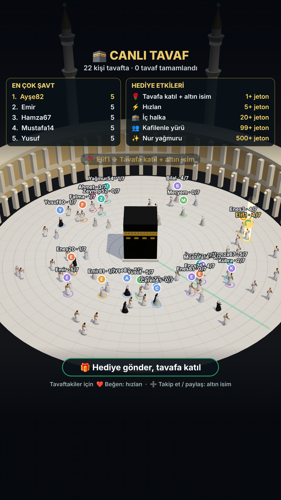
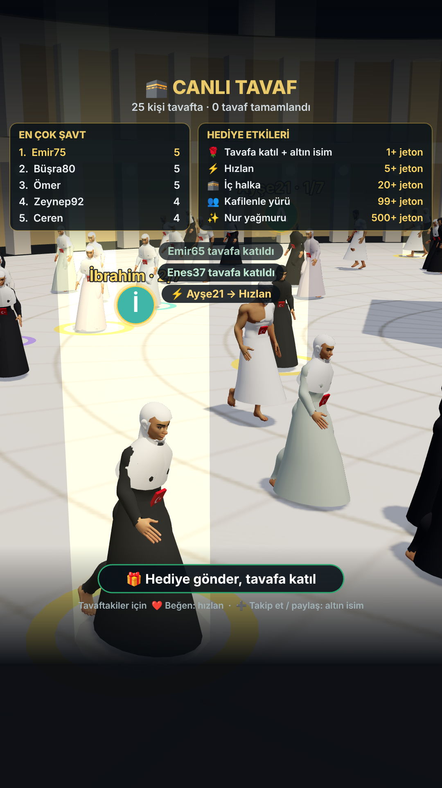

# Canlı Tavaf 3D – TikTok LIVE interaktif oyunu

Three.js ile çizilen 3 boyutlu bir meydan: izleyiciler **hediye göndererek** tavafa katılır, Kâbe'nin etrafında
yürür ve şavtları (0/7) sayılır. Hediyenin jeton değeri büyüdükçe daha büyük efekt tetiklenir.
9:16 dikey (1080×1920) yayın için tasarlandı.

| Geniş açı | Yakın çekim |
|---|---|
|  |  |

| Etkileşim | Sonuç |
|---|---|
| 1+ jeton hediye | Tavafa katılır + altın isim ve ışık sütunu |
| 5+ jeton | Hızlan (2×) |
| 20+ jeton | İç halka (Kâbe'ye yakın, turlar kısalır) + kamera yakın çekim |
| 99+ jeton | Kafilenle yürü (8 kişilik grup) |
| 500+ jeton | Nur yağmuru (tüm meydan aydınlanır, herkes hızlanır, büyük duyuru) |
| Beğeni (tavaftakiler) | Kısa süreli hızlanma |
| Takip / paylaşım (tavaftakiler) | 45 sn altın isim |

7 şavt tamamlanınca "tavafını tamamladı" duyurusu çıkar; "En çok şavt" sıralaması canlı güncellenir.
Kamera geniş açıda süzülür, belirli aralıklarla ve büyük hediyelerde oyuncuya yakın çekim yapar.

## Karakterler

Erkek ve kadın hacılar gerçek 3B insan modelleridir ve iskelet animasyonuyla yürür:

- **Erkek:** ihram (sol omuzdan çapraz rida + izar), saç/sakal çeşitleri
- **Kadın:** uzun pardösü ve başörtüsü (Türk hacı kafilelerindeki açık renkler ve siyah)
- Hepsinde **Türk bayraklı boyun çantası**
- TikTok izleyicinin cinsiyetini vermediği için model kullanıcıya göre rastgele (ama her seferinde aynı) seçilir.

Gövde modelleri ve yürüme animasyonu [Quaternius](https://quaternius.com) tarafından CC0 (kamu malı) lisansıyla
yayımlanmıştır (`public/models/LICENSE.txt`); kıyafetler `public/characters.js` içinde kodla giydirilir.
`tools/prepare_models.py`, özgün paketlerden `public/models` klasörünü yeniden üretir.

## Ayarlar – `public/config.js`

- `joinMode`: `'gift'` (yalnızca hediye gönderen katılır – varsayılan) veya `'comment'` (yorum yazan da katılır)
- `giftTiers`: kademelerin jeton eşikleri, süreleri ve adları
- `lapSeconds`, `lapsPerTawaf`, `idleMinutes`, `maxPlayers`, `closeShotEvery`
- Performans: `backgroundCrowd` (isimsiz kalabalık), `shadows`, `renderScale` – yayın bilgisayarı zorlanırsa önce bunları düşür.
  Hızlı deneme için adrese eklenebilir: `?crowd=20&shadows=0&scale=0.75`

## Kurulum

Node.js 18+ gerekir.

```bash
cd tiktok-live-game
npm install
node server.js TIKTOK_KULLANICI_ADIN     # yayın AÇIKKEN çalıştır
```

- Oyun: <http://localhost:3000/>
- Yayın olmadan deneme: <http://localhost:3000/?demo=1> (sahte izleyiciler)
- Test tuşları: `J` = yeni katılımcı, `1`–`5` = hediye kademeleri

## Yayına ekleme

**TikTok LIVE Studio** veya **OBS**'te bir *Tarayıcı kaynağı / Browser Source* ekle:
URL `http://localhost:3000/`, boyut 1080×1920. Alt kısım TikTok sohbetinin altında kalacağı için boş bırakıldı.
OBS'te tarayıcı kaynağı için donanım hızlandırmanın açık olması gerekir (WebGL).

## Notlar

- Bağlantı, resmî olmayan `tiktok-live-connector` kütüphanesi ile kurulur; TikTok tarafındaki değişiklikler bağlantıyı
  geçici olarak bozabilir. Yoğun kullanımda `EULER_API_KEY` ortam değişkeni ile eulerstream.com anahtarı verilebilir.
- Yayın kopar veya henüz açılmamışsa sunucu 30 sn'de bir yeniden dener.
- Hediye karşılığı katılım içeren yayınlarda TikTok'un LIVE ve hediye kurallarına uyulması yayıncının sorumluluğundadır.
